# Résultats de recette

## REC-01 — Import idempotent
1. 2. Première éxécution :
-> Stations importées : 120 / 120 
-> Trajets importés : 2009 / 2030
-> Incidents importés : 177 / 180

3. 4. Seconde éxécution : 
-> Stations importées : 120 / 120
-> Trajets importés : 2009 / 2030
-> Incidents importés : 177 / 180

### Résultat attendu
- Les deux exécutions se terminent sans erreur
- les trois comptages sont identiques entre les étapes 2 et 4 
- `count(*) FROM station` vaut 120.

### Résultat obtenu

extrait de rapport du rapport de fiabilisation :
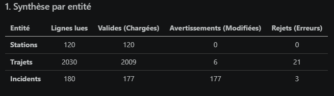


- Les deux exécutions se terminent sans erreur **OK**
- les trois comptages sont identiques entre les étapes 2 et 4 **OK**
- `count(*) FROM station` vaut 120 **OK**

### Statut
OK

## REC-02 — Rejets journalisés et cohérence des volumes

### Résultat attendu

Pour chaque fichier : importées + rejetées + doublons écartés = lignes du CSV. Chaque ligne du journal porte les six informations. La requête de l'étape 4 renvoie 0.

### Résultat obtenu

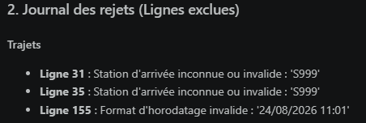
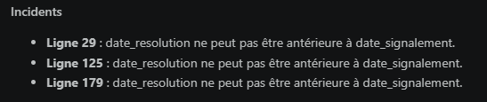
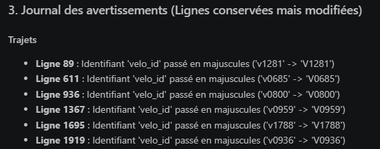

### Statut
KO :
- Le journal ne donne pas les informations sous la forme attendue
- Relancer le fichier `importer.py` relance tout le processus depuis les données brutes et ne reprend pas les données nettoyées ; l'étape 4 donne donc le même résultat que l'étape 2

## REC-03 — Connexion acceptée

### Résultat obtenu

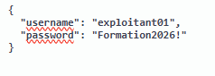
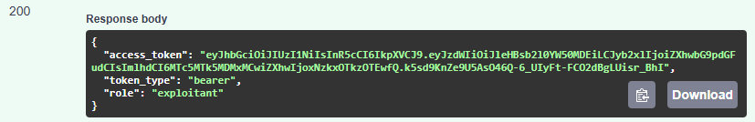

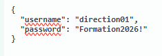
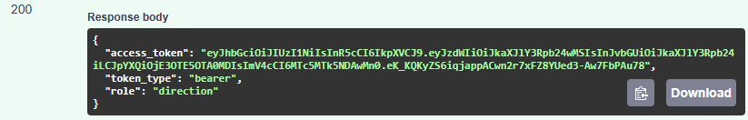

### Statut

OK

## REC-04 — Connexion refusée

### Résultat obtenu
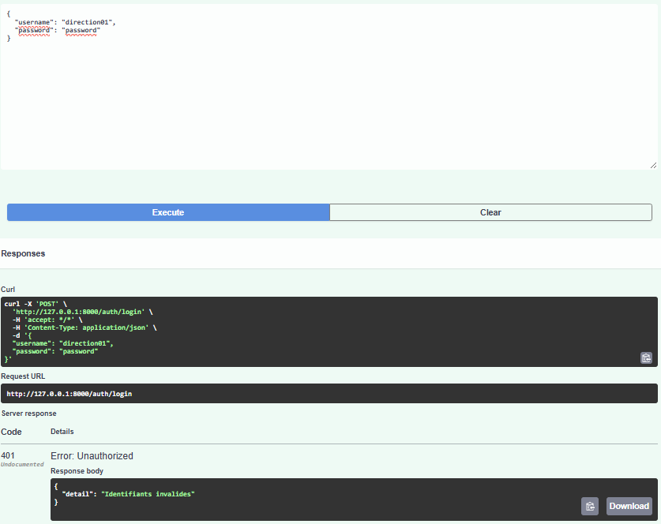


### Statut

OK

## REC-05 — Route protégée sans jeton

### Résultat obtenu
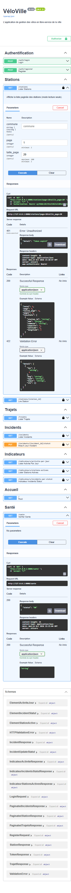
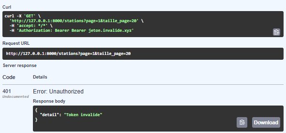
 
### Statut

OK

## REC-06 — Rôle direction refusé sur la modification d'un incident

### Résultat obtenu
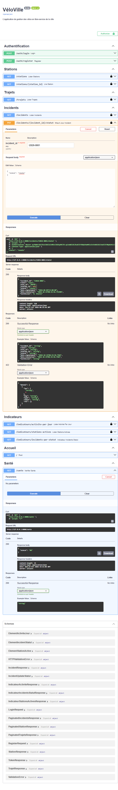
- le jeton direction permet la modification de statut d'un incident.
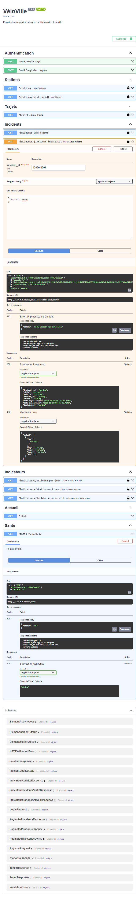
- Refaire la même demande une seconde fois donne une réponse 422

### Statut

KO

## REC-07 — Pagination

### Résultat obtenu

1. 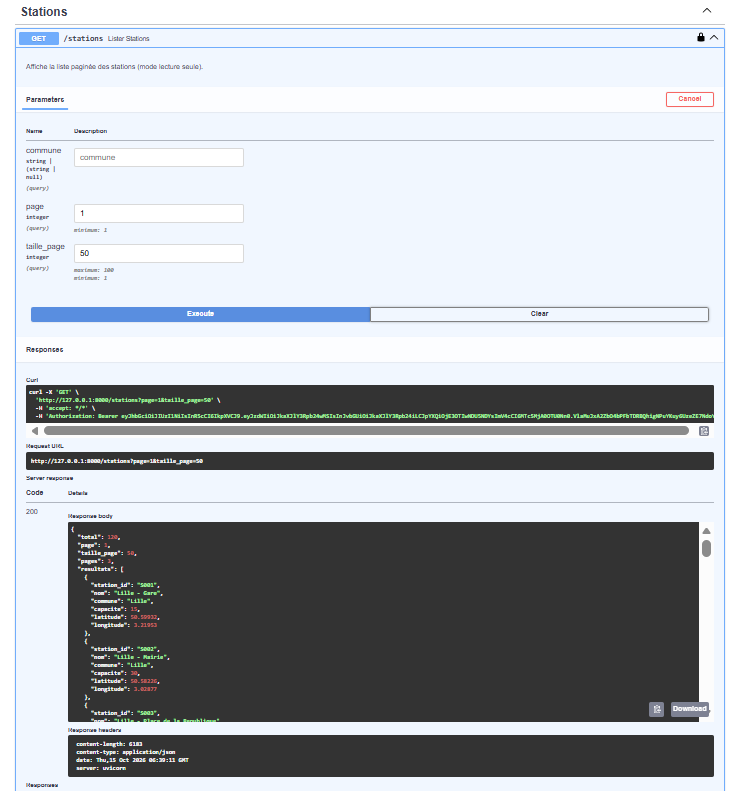
2. 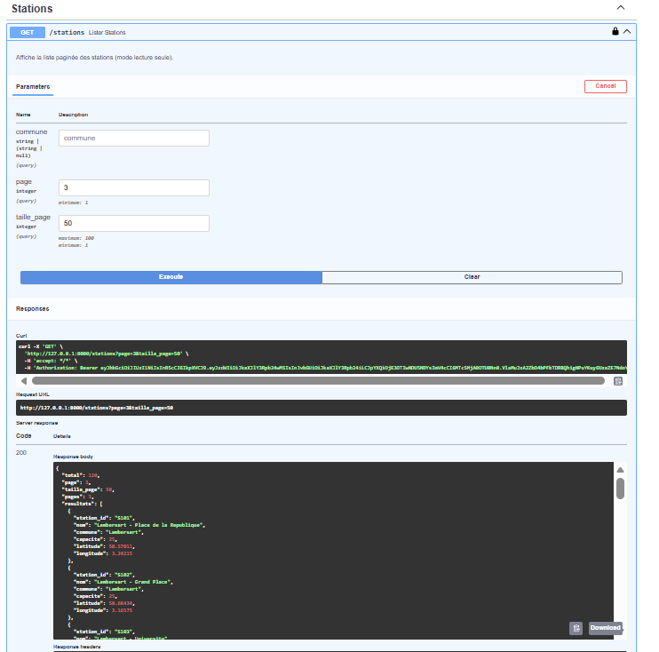
3. 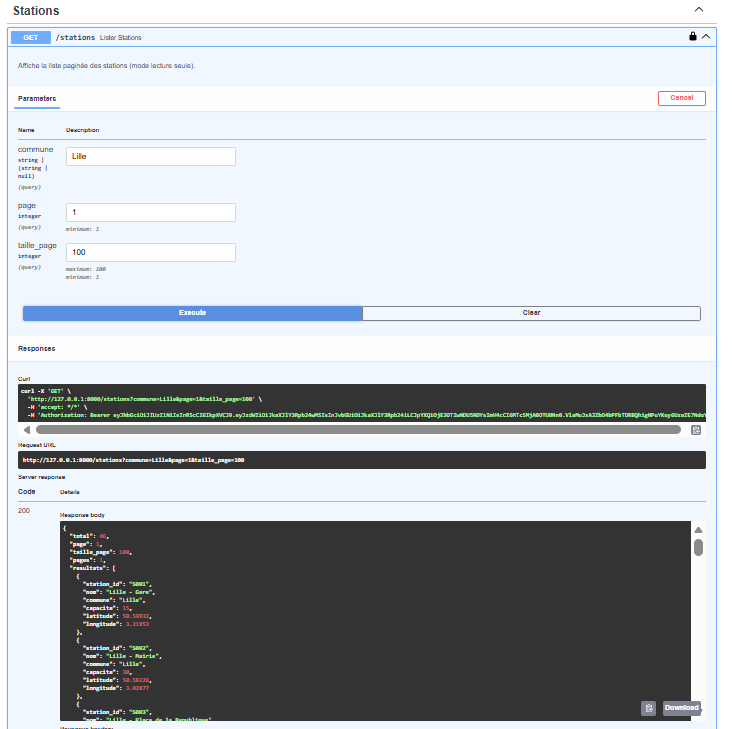
4. 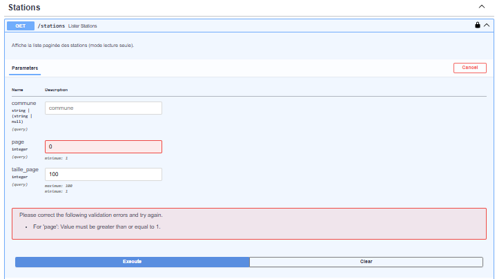
le swagger donne la page 0 comme incorrecte
5. 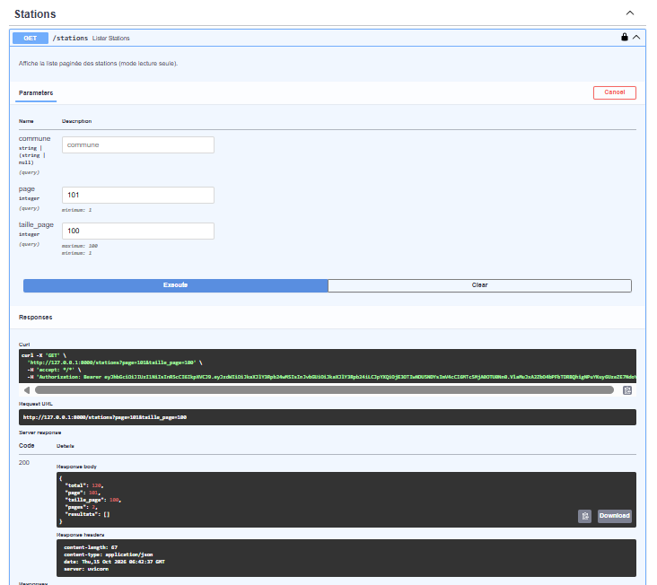
le swagger affiche une réponse 200 avec liste vide

### Statut

KO

## REC-08 — Station introuvable

### Résultat obtenu

1. 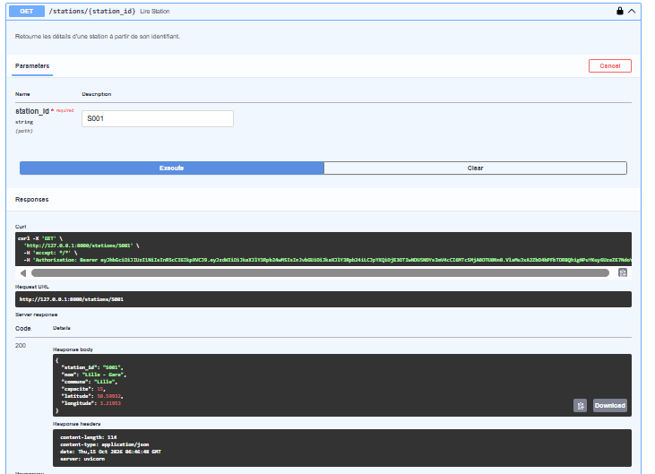
2. 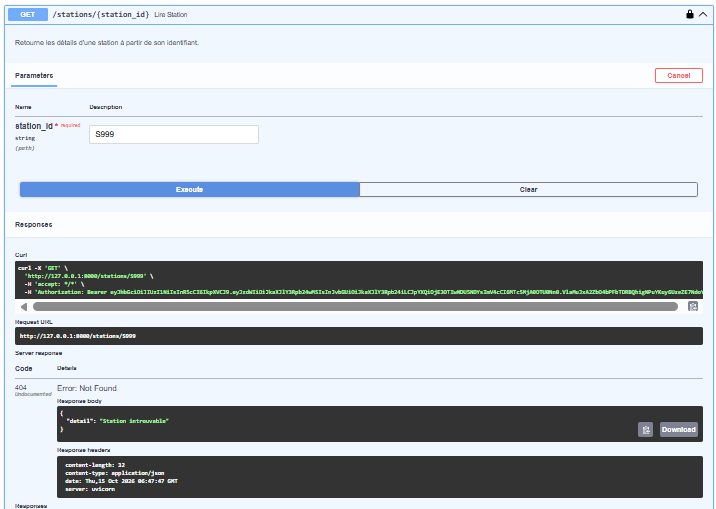

### Statut

OK

## REC-09 — Cohérence de l'indicateur « activité par jour » avec la base

### Résultat obtenu

1. 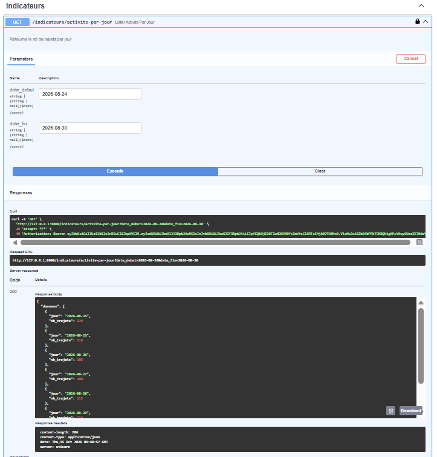
2. 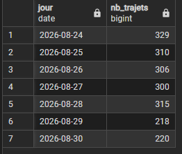
3. lignes exactement les mêmes
4. `GET /trajets?date_debut=2026-08-24&date_fin=2026-08-30` `total : 1998`
```
Somme des indicateurs récupérés : 
S = 329 + 310 + 306 + 300 + 315 + 218 + 220
S = 2028
```


### Statut

KO

## REC-10 — Front : état vide et état d'erreur

### Résultat obtenu

1. 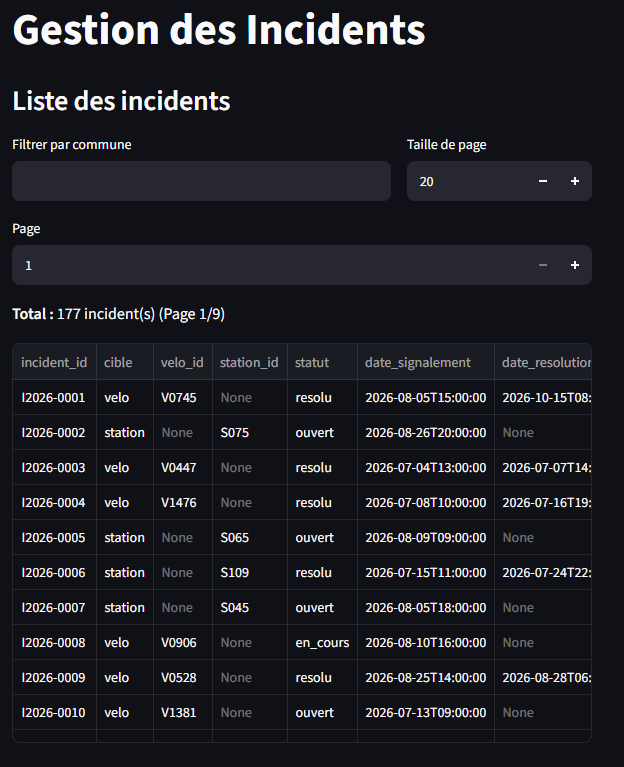 NT : Le frontend ne prévoit pas de filtrer par le statut de l'incident
2. 3. 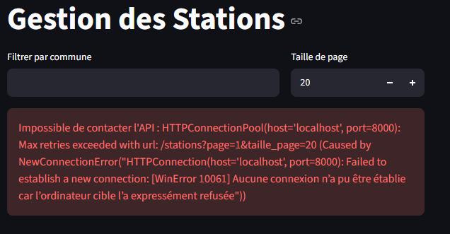
4. 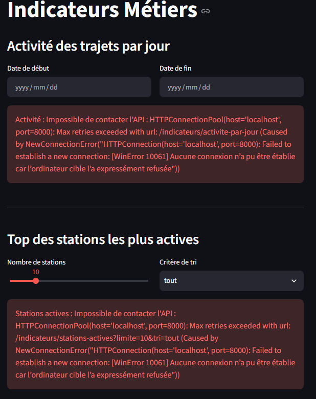
5. 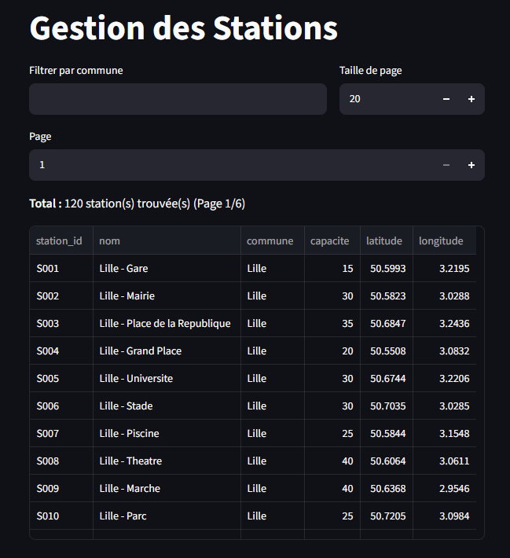

### Statut

OK